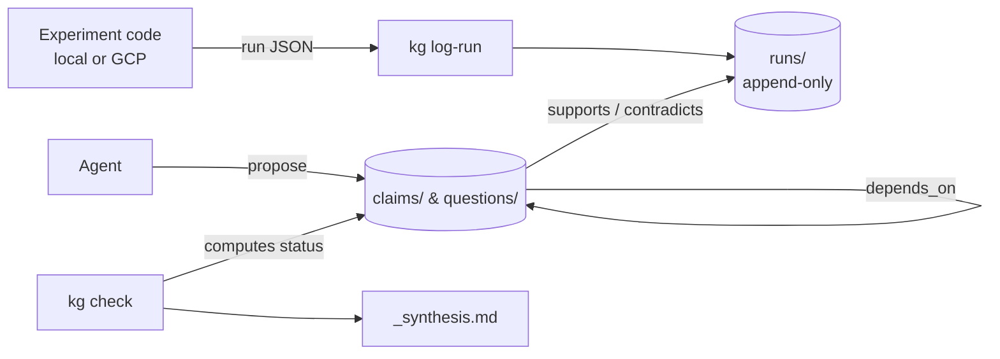

# kg

**A research memory for agents that keeps facts and hypotheses apart.**

kg stores experiment provenance and the claims drawn from it as plain Markdown notes in an Obsidian vault. Agents write hypotheses. Code decides what counts as established, based on the runs that back each claim. When a run turns out to be broken, every conclusion built on it is flagged automatically.



## Why

Persistent memory helps an agent pick up where it left off, but it also causes two problems:

- **Anchoring.** A note saying "X didn't work" stops the agent from ever revisiting X, even if it failed because of a bug.
- **Compounding errors.** An interpretation gets saved, retrieved later as fact, and built on.

kg addresses both. Provenance and interpretation live in separate layers. Every claim cites the runs behind it and the conditions it was tested under. Status comes from evidence, never from the agent's own say-so.

## Install

```bash
git clone https://github.com/IsaacAnwar/research-ontology-for-my-agents-memory.git
cd research-ontology-for-my-agents-memory
uv tool install .
kg init ~/path/to/vault/experiments
export KG_VAULT=~/path/to/vault/experiments
```

Connect it to your agent. The server is `kg-mcp` over stdio with `KG_VAULT` set. For Claude Code:

```bash
claude mcp add kg -s user -e KG_VAULT=$KG_VAULT -- kg-mcp
```

Agents working inside this repo read setup and conventions from [AGENTS.md](AGENTS.md).

Open `kg.base` in Obsidian to browse claims, runs, and questions as tables.

## The graph

| Node | Folder | Written by |
| --- | --- | --- |
| Run | `runs/` | `kg log-run`, from experiment output |
| Claim | `claims/` | agents, via `propose` |
| Question | `questions/` | agents, via `propose` |

| Edge | From | To |
| --- | --- | --- |
| `supports` | claim | run |
| `contradicts` | claim | run |
| `depends_on` | claim | claim |
| `related` | claim or question | anything |

## Claim status

`kg check` computes status from valid runs only:

| Status | Rule |
| --- | --- |
| `refuted` | more contradicting runs than supporting |
| `contested` | at least one contradicting run |
| `established` | 2+ supporting runs and `approved_by` set by a human |
| `supported` | 2+ supporting runs |
| `preliminary` | 1 supporting run |
| `untested` | no runs yet |
| `blocked` | evidence holds, but a claim it depends on does not |

## Agent tools

Six MCP tools, used as a routine:

| Tool | Use |
| --- | --- |
| `search` | find duplicates and prior runs, after brainstorming |
| `why` | evidence tree from a claim down to raw runs |
| `impact` | everything downstream of a run or claim |
| `propose` | create a claim or question, or add links and notes |
| `invalidate` | mark a run broken and see what falls |
| `check` | recompute statuses and report problems |

The routine ships in the server instructions, so any MCP client gets it:

1. Brainstorm before reading the graph.
2. `search` each idea.
3. `why` a claim before relying on it.
4. `propose` questions and claims, citing run ids.
5. `invalidate` runs with bugs.
6. `check` at the end of a session.

## Logging runs

Experiment code writes one JSON object per run. Nothing needs to be installed where the experiment runs.

```json
{
  "id": "optional-run-name",
  "git_sha": "3f2a9c1",
  "git_dirty": false,
  "data_version": "dataset-v2",
  "config": {"model": "resnet18", "lr": 0.001},
  "metrics": {"val_acc": 0.812},
  "artifacts": ["gs://bucket/runs/0041/"],
  "notes": "becomes the note body"
}
```

```bash
kg log-run run.json
gcloud storage cat gs://bucket/runs/*.json | kg log-run
```

## CLI

```bash
kg init <path>
kg log-run [files...]
kg check
kg search "augmentation resnet" --kind claim
kg why <claim>
kg impact <run-or-claim>
kg invalidate <run> --reason "val split leak"
echo '{"kind": "claim", "statement": "...", "supports": ["run-0001"]}' | kg propose
```

## License

MIT. See [LICENSE](LICENSE).
